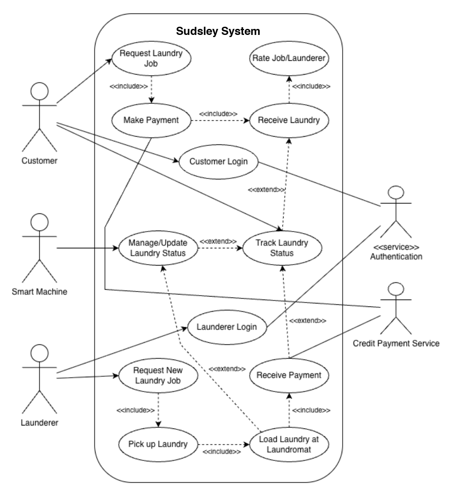

# Example HW1 submission

An example of the kind of system description and diagram students submit. An example HW2 is in
[`hw2-component-design/example/example-submission.md`](../../hw2-component-design/example/example-submission.md).

---

## Sudsley high-level design

Sudsley is described as a "disruptive new startup" that aims to smartify laundry. The heart of
Sudsley is the next-generation, proprietary laundry machine and dryer built by in-house
engineers. Each machine is internet-enabled and has an integrated API that allows for complete
remote control and monitoring (start/stop cycle, fetch statuses). With this in mind, along with
the must-haves for the MVP requirements discussed in class, I believe the system will be
divided into three sides: Customers, Launderers, and Machine/Laundromat owners (will
machines/laundromats be franchised or exclusively owned by Sudsley?). The job flow I envision
looks as follows:

1. **Job request.** The Customer requests a job via the mobile app, logging pickup details and
   preferences.
2. **Dispatch and transport.** The Geospatial Service assigns the nearest Launderer for
   pickup, who then transports the items to a partner Laundromat.
3. **Smart processing.** The Backend assigns a specific Smart Machine. The Launderer loads the
   clothes, and the IoT Service remotely triggers the start cycle.
4. **Real-time status.** The Smart Machine reports its status and geographical location
   (Laundromat) to the IoT Service, which is relayed to the Customer app.
5. **Delivery and financials.** The Launderer performs the return delivery. The Payment
   Service processes the transaction, billing the Customer and paying the Launderer.
6. **Review and data.** The Customer rates the overall job and Launderer, and all operational
   telemetry is captured by the Analytics Service.

---

## Instructor notes

- The description traces one job end to end, which makes the components easy to find.
- It asks a requirements question instead of assuming an answer (franchised or company-owned
  laundromats). That is worth raising in class.
- The diagram is a use-case diagram rather than a component diagram. The assignment allows
  either; compare it with the [model design](../../../scenario/high-level-design.md) to
  discuss what each view shows and hides.
