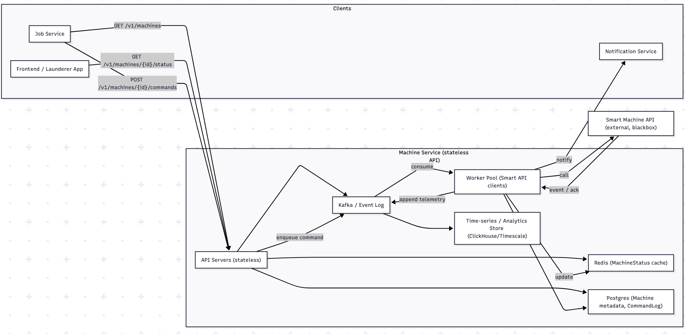

# Example HW2 submission

An example component-level design of the Machine Service, of the kind students submit.

---

## Machine Service component-level design

### What exact data fields should it store?

- **Machine:** `machine_id`, `external_machine_id`, `location_id`, `model`, `serial_number`,
  `capabilities`, `installed_at`, `status_last_seen`, `is_active`, `metadata`
- **MachineStatus:** `machine_id`, `state`, `cycle_id`, `cycles_progress`, `cycle_type`,
  `eta_seconds`, `last_updated`, `last_error`, `raw_payload`
- **MachineTelemetry:** `machine_id`, `timestamp`, `cycle_event`, `payload`
- **MachineCommandLog:** `command_id`, `machine_id`, `issued_by`, `commands`, `params`,
  `issued_at`, `sent_at`, `ack_at`, `completed_at`, `status`

### Does it need an API? If so, what endpoints?

Yes, an internal REST/gRPC API: `GET /machines`, `GET /machines/{id}`,
`GET /machines/{id}/status`, `POST /machines/{id}/commands`, `GET /commands/{id}`,
`/history`.

### What latency is acceptable?

Reads ≤ 150 ms, command acceptance ≤ 200 ms, delivery to the Smart Machine API < 1 s, device
acknowledgement < 5 s.

### How consistent should it be?

Machine metadata should be strongly consistent. Status should be near-real-time eventual
consistency, with read-after-write behavior for commands.

### How much storage is needed?

With 10,000 machines sending telemetry every 10 s, that is about 86,400,000 records a day,
or 17.28 GB a day.

### How many read vs. write requests?

Estimate a 10–50:1 read-to-write ratio initially.

### Is the data structured and relational, or more flexible?

Hybrid: relational for metadata, with flexible JSON fields and a time-series store for
telemetry.

### How will the service scale?

Horizontally: stateless API servers, Redis cluster shards, Kafka partitions, worker
autoscaling, database replicas, and region partitioning.

### Does it need a cache?

Yes, Redis for MachineStatus and hot queries.

### Is it stateless?

The API servers are stateless. The workers scale out but are stateful during operations.

### Does it need rate limiting?

Yes: per machine, per client, and toward the external Smart Machine API.

### What key metrics should it log?

Request latencies, external call latencies, command success and failure, telemetry ingestion
rate, Redis hit rate, Kafka lag, machine uptime, and failed cycle rate.

### Does it have external dependencies? What are the limits?

The Smart Machine API, Identity Services for authentication, and the Notification Service
for alerts. Limits should be documented and guarded with rate limiting and circuit breakers.

### Design diagram

---

## Instructor notes

- **Scoped to one service.** Every answer is about the Machine Service, and the diagram shows
  who calls it (the Job Service and the Launderer App) and what it calls.
- **Commands are asynchronous.** Requests are queued, workers talk to the Smart Machine API,
  and acknowledgements flow back, with a command log to track each one. The latency answer
  separates accepting a command from the device acknowledging it, which matches that design.
- **The storage estimate shows its work.** 10,000 machines × one record every 10 s =
  86.4 million records a day; 17.28 GB implies about 200 bytes a record.
- **Justifications are thin.** Most answers state a decision without saying why, for example
  "Yes, Redis for MachineStatus and hot queries." The HW2 rubric asks for a justification for
  each answer; ask students to supply the missing reasons.
- **Questions for discussion.**
  - The MVP brief sizes Sudsley by customers (10k), not machines. How many machines does
    10k customers actually need, and how does that change the estimate?
  - Telemetry every 10 s is a constant write stream, yet the answer to question 6 is
    10–50:1 read-heavy. Which traffic is that ratio describing?
  - Kafka, a worker pool, Redis, Postgres, and a time-series store is a lot for an MVP. Which
    pieces would you build first?
  - The written endpoints are `/machines/...`, but the diagram uses `/v1/machines/...`, and
    `/history` names no resource. What should the API contract say, and where does
    versioning belong?
