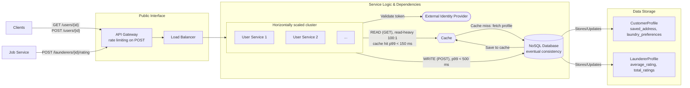

# The component architecture questions

High-level design identifies the components. Component-level design zooms in on one of them
and moves from the *what* to the *how*. If the high-level design is an architect's floor plan
of a house, a component-level design is the schematic for just the kitchen: where the sink,
stove, and dishwasher go and how their plumbing and wiring connect.

A component-level design defines the component's responsibilities, describes its internal
logic, and specifies how it interacts with other services and external dependencies. These
thirteen questions structure that work. Lecture 2
(`slides/2-high-level-and-component-design.pdf`) demonstrates them on the User Service, and
[HW2](../assignments/hw2-component-design/HOMEWORK.md) applies them to the Machine Service.

## The questions

| # | Question | What it decides |
|---|---|---|
| 1 | What exact data fields should it store? | The data model: what this service is responsible for, separate from data other services manage. |
| 2 | Does it need an API? If so, what endpoints? | The service's contract with the outside world: the functions other services and the client apps can call. |
| 3 | What latency is acceptable? | The speed target. How fast the service must respond drives technology choices such as database speed and caching. |
| 4 | How consistent should it be? | Whether written data must be readable everywhere immediately (strong consistency) or a short delay is acceptable (eventual consistency). |
| 5 | How much storage is needed? | A capacity estimate, to choose a database plan and prepare for scaling. |
| 6 | How many read vs. write requests? | The traffic pattern, which is critical for choosing a database and caching strategy. |
| 7 | Is the data structured and relational, or more flexible? | The core database choice: SQL for structured, relational data; NoSQL for flexible, document-shaped data that scales more easily. |
| 8 | How will the service scale? | How to grow from 10k to 10M users: vertical scaling (a bigger server) or horizontal scaling (more identical servers). |
| 9 | Does it need a cache? | Whether to put a fast in-memory store such as Redis in front of the database for frequently read data. |
| 10 | Is it stateless? | Whether the service remembers information between requests (stateful) or receives everything it needs with each request (stateless). |
| 11 | Does it need rate limiting? | A security and cost control: whether to cap how often one user or IP address can call it. |
| 12 | What key metrics should it log? | What to monitor. You can't fix what you can't see. |
| 13 | Does it have external dependencies? What are the limits? | What the service relies on, and what happens when each dependency fails. |

Later answers build on earlier ones. The read/write ratio (6) justifies the cache (9), and
statelessness (10) is what makes horizontal scaling (8) possible. Check that the answers agree
with each other.

## Worked example: the User Service

The instructor reasons aloud through each question in class. These are the answers given.

1. **Data fields.**
   Customer profile: `user_id`, `display_name`, `saved_address`, `laundry_preferences`.
   Launderer profile: `user_id`, `display_name`, `average_rating`, `total_ratings`,
   `is_active`.
2. **API.** Yes.
   `GET /users/{user_id}` reads a profile; `POST /users/{user_id}` updates one;
   `GET /launderers/{launderer_id}/rating` reads a rating;
   `POST /launderers/{launderer_id}/rating` writes one.
3. **Latency.** Reads must be very fast, under 150 ms at p99. Writes can be slower, under
   500 ms.
4. **Consistency.** Eventual consistency is acceptable. A profile update can take a few
   seconds to propagate, and not every customer needs to see a launderer's new rating
   immediately.

   *Worth asking students:* is that true of every field? If a customer changes
   `saved_address` and requests a pickup straight away, the Job Service could read the old
   address and send the launderer to the wrong house. Fields that the next request depends on
   need read-your-writes consistency, for example by reading them from the database rather
   than a replica or cache right after an update.
5. **Storage.** Very little at first. 10k MVP users × about 5 KB per profile = 50 MB, which is
   trivial for a modern database.
6. **Reads vs. writes.** Highly read-heavy, about 100:1. A profile is read every time the app
   opens and updated occasionally; ratings are read constantly and written once per job.
7. **Data model.** NoSQL, such as DynamoDB or MongoDB. A profile is self-contained, so it can
   be stored as one document, which suits a read-heavy load, and a flexible schema makes it
   easy to add preferences later.
8. **Scaling.** Horizontal: several identical User Service instances behind a load balancer.
   This works because the service is stateless (question 10).
9. **Cache.** Yes, for example Redis. The service is read-heavy and profiles rarely change, so
   check the cache first and skip the database on a hit. That speeds up responses and protects
   the database.
10. **Stateless.** Yes, completely. Horizontal scaling requires it. Each request carries a
    token from the Identity Provider, so any server can handle any request.
11. **Rate limiting.** Yes, on the write endpoints, so a malicious script can't change a
    user's address 1,000 times a second. For example, at most 10 profile updates per minute.
12. **Metrics.** Request latency at p99, error rate (the share of requests that fail), and
    cache hit rate (the share of reads served from the cache rather than the database).
13. **Dependencies.** Three. If the database is down, the service can't read or write any data.
    If the cache is down, reads fall back to the database: slower, but still working. If the
    Identity Provider is down, it can't validate tokens, so every request fails
    authentication.

### Component diagram

