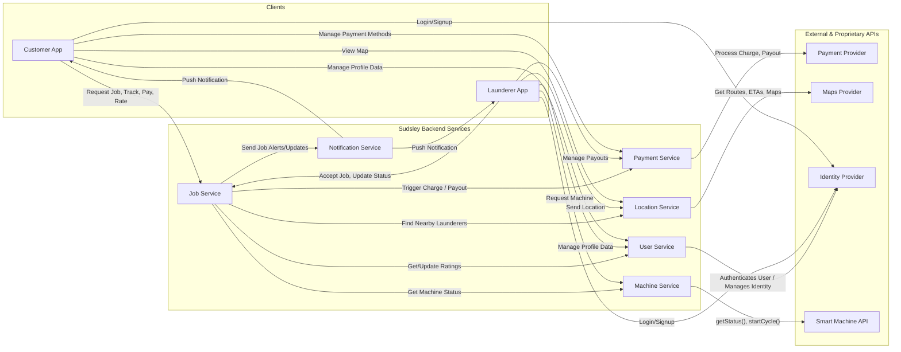

# Sudsley high-level design

The model high-level design for Sudsley, presented in lecture 2
(`slides/2-high-level-and-component-design.pdf`) after HW1 is submitted. HW2 starts from it.

There is no single correct design. This one is a reference point for discussion, not an answer
key for HW1.

## Clients

There is a mobile app for each type of user, the **Customer App** and the **Launderer App**.
They have distinct purposes and make slightly different API calls. A frontend team builds
them.

## Backend services

- **Job Service.** The "brain": the core service that orchestrates the whole laundry process,
  from job creation and launderer matching to tracking the job's status. Its main purpose is
  to call and notify other services, which is why this kind of service is often called an
  orchestrator.
- **Payment Service.** Charges customers and manages payouts to launderers. Integrates with
  the Payment Provider for all financial transactions.
- **Location Service.** Tracks the real-time location of launderers. Integrates with the Maps
  Provider for ETAs and routes.
- **Machine Service.** Finds available machines at Sudsley locations and remotely starts and
  monitors laundry cycles. Talks to the Smart Machine API. Students design it in HW2 and
  implement it in HW3.
- **User Service.** Manages customer and launderer profile data, which is distinct from
  authentication: saved addresses, preferences, and aggregated ratings. Links the user's
  identity from the Identity Provider to their application data. It is the worked example in
  [`framework/component-architecture-questions.md`](../framework/component-architecture-questions.md).
- **Notification Service.** Sends real-time push notifications and alerts to customers and
  launderers about job updates.

## External services

- **Payment Provider** (for example Square or Stripe). Securely processes payments and
  payouts. Sudsley stores no financial information.
- **Maps Provider** (for example Google Maps). Mapping, geocoding, and route planning.
- **Identity Provider** (for example Auth0, Okta, or Cognito). All authentication: sign-up,
  login, and credential management. Sudsley stores no passwords or credentials.
- **Smart Machine API.** Sudsley's own proprietary API for getting the status of and
  controlling the machines. It is "external" in the sense that the backend treats it as a
  black box that works.
